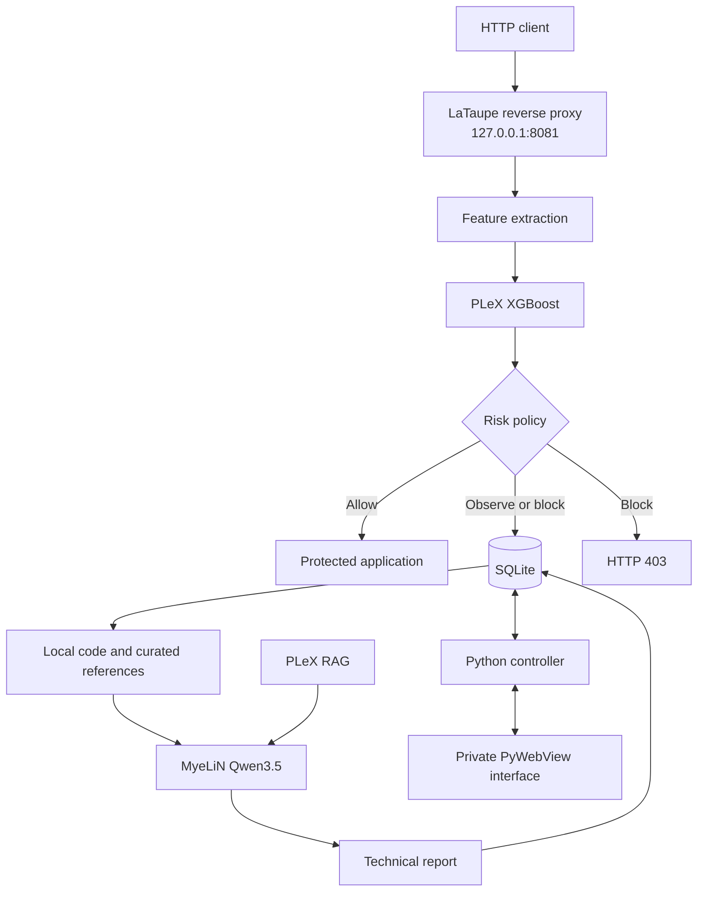

<p align="center">
  
</p>

LaTaupe is a desktop, ML-powered Web Application Firewall for protecting a local web application through an HTTP reverse proxy. It makes the blocking decision synchronously with an XGBoost model compiled by PLeX and produces a separate, asynchronous technical report with Qwen3.5 through the MyeLiN runtime.

## Architecture



The XGBoost classifier is the enforcement path. Qwen3.5 never decides whether a request is released: it runs after a mitigation, inspects the untrusted payload, relevant local source excerpts and an internal allowlist of manually registered security references, distinguishes an attempted attack from a confirmed weakness, and stores an auditable report. Request data cannot add or replace reference URLs.

The desktop interface does not expose a dashboard API or web server. JavaScript talks directly to the Python controller through the private PyWebView bridge. Closing the window keeps protection in the system tray.

## Layout

```text
src/
├── app/       desktop UI, proxy, policy, persistence and MyeLiN integration
└── model/     PLeX manifest, XGBoost graph, training and compiled artifact
```

## Requirements

- Python 3.11 or newer;
- a PLeX/MyeLiN build for compiling or running `.mln` artifacts;
- PySide6/QtWebEngine for the desktop WebView;
- an HTTP application to protect.

## Run from source

```bash
git clone https://github.com/useplx/LaTaupe.git
cd LaTaupe
python -m venv .venv
source .venv/bin/activate
python -m pip install -e .

export LATAUPE_UPSTREAM_HTTP=http://127.0.0.1:3000
export LATAUPE_SOURCE_ROOT=/path/to/upstream/source
lataupe
```

The protected application is then available through `http://127.0.0.1:8081`. The proxy port can be changed with `LATAUPE_PROXY_PORT`.

## Models

### XGBoost enforcement

Build the WAF artifact with SYNaPSe:

```bash
cd src/model
synps build --release
install -m 0644 build/lataupe.mln assets/lataupe.mln
```

Python does not import XGBoost during inference. Training exports the fitted trees to C++; PLeX compiles the graph and orchestration into `lataupe.mln`; the application invokes it only through the MyeLiN Python wrapper.

### Qwen3.5 reports

LaTaupe uses the typed contract from the independent `qwen35-interface`
package. MyeLiN remains model-agnostic and only transports the encoded input
buffer. Point LaTaupe to a composed, text-only Qwen3.5 artifact:

```bash
export LATAUPE_QWEN_ARTIFACT=/path/to/qwen3.5-rag.mln
```

Alternatively, install the artifact as `src/model/assets/qwen3.5.mln`; LaTaupe discovers it automatically and Nuitka includes it through package data. The artifact is a deployment input and is intentionally not stored in this source repository. The report worker is asynchronous and records four explicit outcomes:

- `falha-confirmada`;
- `possivel-falha`;
- `tentativa-sem-falha-confirmada`;
- `codigo-nao-localizado`.

PLeX/RAG belongs to the composed MyeLiN artifact, not to the Python application. It augments Qwen3.5 inside the artifact; Python supplies the request using the package-owned Qwen3.5 interface, receives UTF-8 output, and persists the report and evidence sources.

The local CPU profile uses Q4K for the embedding and large attention/MLP matrices,
keeps normalization, bias and recurrent state in F16, uses a 1024-token context,
greedy decoding and a 384-token output budget. The resulting artifact is about
1.2 GB instead of 3.6 GB.
Reports stream partial text into SQLite and remain secondary and asynchronous,
so model warm-up never delays the proxy decision.
Reports use a fixed Markdown structure and are rendered by `markdown-it-py`,
then sanitized with `nh3` before entering the private WebView document.

### Runtime devices

`synps.toml` defines which IREE targets are compiled into each artifact;
`myelin.toml` only selects and configures compatible devices at execution time.
Backend tables form an allowlist and configure each registered driver. This
configuration enables CUDA when operational and creates a private eight-worker
IREE executor for CPU execution:

```toml
[runtime]
memory = "8GiB"
scheduler = "static"
profiling = true

[backend.local]
device = "local"
ordinal = 0
threads = 8

[backend.cuda]
device = "cuda"
ordinal = 0
```

The application reads `Metadata.backends` from each `.mln` and builds separate
selectors for XGBoost and Qwen3.5 under **Settings**. The choice is persisted
and applied on the next start; **Automatic** preserves the ordered alternatives
compiled into that artifact. No backend list is hardcoded in the application.
Qwen3.5 uses CUDA for interactive report latency. Projection matrices remain Q4K, while the
tied embedding/LM-head matrix uses Q8 so NVPTX never receives an unsupported
sub-byte gather. The CPU artifact can be compiled from the same package by
selecting `local`; Vulkan is not enabled because IREE cannot yet lower this
model's online-attention workgroup buffers.

## Desktop controls

The top-right light reflects enforcement immediately:

- green: the filter is enabled and malicious requests can be blocked;
- red: observation mode is enabled and requests are only recorded.

Language, enforcement and risk thresholds live under **Settings** and persist in SQLite. The selected language applies to the interface and subsequent Qwen reports.
The proxy port and the independent XGBoost/Qwen backends are configured there
as well. Port and backend changes take effect on the next application start.

## Controlled SQL injection demo

The isolated lab reproduces
[CVE-2021-35042](https://www.djangoproject.com/weblog/2021/jul/01/security-releases/),
an SQL injection in Django `QuerySet.order_by()`. It runs vulnerable Django
3.2.4 and MySQL in containers. Images are pinned by digest, the database is
private, and fixture setup is automatic.

```bash
cd demo/sql-injection
docker compose up -d
```

Then start LaTaupe directly from Python source at the repository root:

```bash
LATAUPE_UPSTREAM_HTTP=http://127.0.0.1:3000 \
LATAUPE_PROXY_PORT=8081 \
PYTHONPATH=src python -m app.main
```

Nuitka is not used in this workflow. In another terminal, attack only the
LaTaupe endpoint with the installed SQLMap executable:

```bash
sqlmap -u 'http://127.0.0.1:8081/vuln/?order=vuln_collection.name%29%3Bselect%20updatexml%281%2Cconcat%280x7e%2C%28select%20%40%40version%29%29%2C1%29%23' \
  --batch --dbms=MySQL --level=1 --risk=1 --flush-session
```

With enforcement enabled, LaTaupe should return `403` before SQLMap reaches
Django. There is no attacker container and no Python attack script.
Mitigations appear immediately; Qwen reports remain asynchronous. SQLMap and
detailed teardown and network notes live in
[`demo/sql-injection/README.md`](demo/sql-injection/README.md). Only scan this
local lab or systems you are explicitly authorized to assess.

## Compile with Nuitka

```bash
python -m pip install -e '.[bundle]'
PYTHONPATH=src python -m nuitka --output-dir=release src/app/main.py
```

The standalone executable is written to `release/main.dist/lataupe`. Build the WAF artifact first. The build bundles that artifact, LibDOM-generated UI, JavaScript assets and QtWebEngine. A `qwen3.5.mln` artifact is included when present in `src/model/assets`; the MyeLiN shared library must be provided by the target deployment or its packaging pipeline.

## Safety model

- Payload and application source are treated as untrusted data in the assistant prompt.
- Reports cannot override the synchronous enforcement result.
- Client addresses are pseudonymized before persistence.
- Request bodies are size-limited before feature extraction.
- The desktop bridge is private to the embedded WebView.

## License

LaTaupe is licensed under the PolyForm Noncommercial License 1.0.0. Dataset, model weights, PLeX packages and third-party dependencies retain their own licenses.
